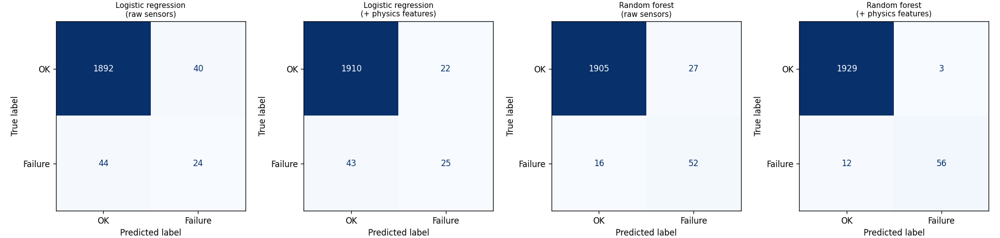
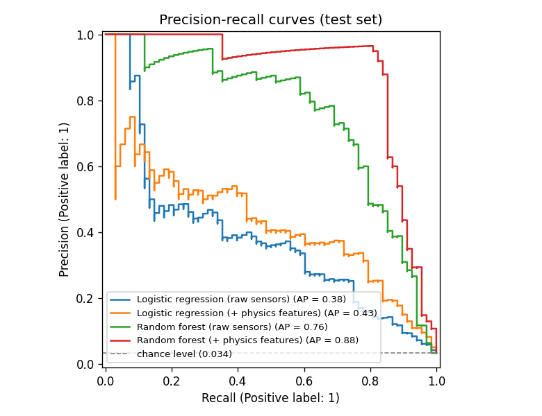
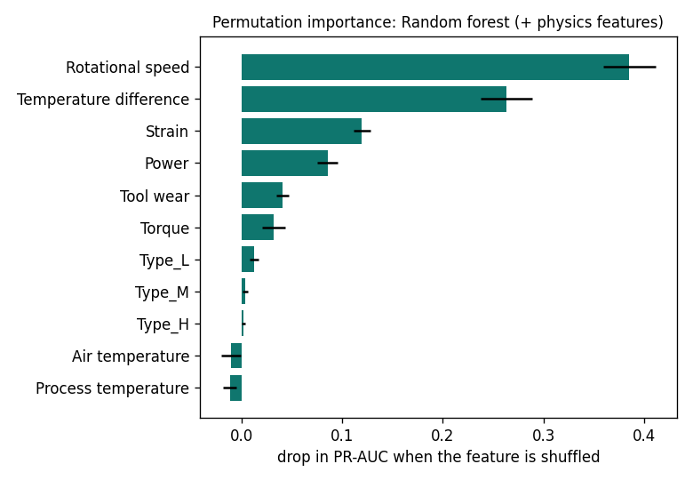

# Failure Predictor: Predictive Maintenance on AI4I 2020

[](https://github.com/chandanarashwathappa/failure-predictor/actions/workflows/ci.yml)

Predicts whether a milling machine will fail from its sensor readings, on the
[AI4I 2020 Predictive Maintenance dataset](https://archive.ics.uci.edu/dataset/601/ai4i+2020+predictive+maintenance+dataset)
(10,000 records, **3.4 % failures**). The focus is on doing it **honestly**: no
label leakage, metrics that make sense for rare failures, a decision threshold chosen
without touching the test set, and tests that guard model quality in CI.

## Results (test set, 2,000 machines, 68 failures)

| Model | Threshold | Accuracy | Precision | Recall | F1 | PR-AUC | Missed failures | False alarms |
|---|---|---|---|---|---|---|---|---|
| Always "no failure" (baseline) | – | **0.966** | 0.000 | 0.000 | 0.000 | 0.034 | 68 | 0 |
| Logistic regression (raw sensors) | 0.88 | 0.958 | 0.375 | 0.353 | 0.364 | 0.382 | 44 | 40 |
| Logistic regression (+ physics features) | 0.92 | 0.968 | 0.532 | 0.368 | 0.435 | 0.430 | 43 | 22 |
| Random forest (raw sensors) | 0.35 | 0.979 | 0.658 | 0.765 | 0.707 | 0.755 | 16 | 27 |
| **Random forest (+ physics features)** | 0.44 | **0.993** | **0.949** | **0.824** | **0.882** | **0.878** | **12** | **3** |

The best model catches **56 of 68 failures with only 3 false alarms** among 1,932
healthy machines.



### What the numbers show

1. **The accuracy trap.** A "model" that always says *no failure* is 96.6 % accurate
   and completely useless. That's why this project reports precision, recall, F1 and the
   area under the precision-recall curve (PR-AUC) instead.
2. **Physics-based features matter more than the model choice alone.** Three features
   derived from how the failure modes work raise the random forest's PR-AUC from
   0.755 to 0.878 and cut false alarms from 27 to 3:
   - `Temperature difference` = process − air temperature (heat dissipation failure)
   - `Power` = torque × angular speed (power failure)
   - `Strain` = tool wear × torque (overstrain failure)
3. **Linear models are not enough.** The failure rules are thresholds and windows
   (for example power below 3,500 W *or* above 9,000 W), which a logistic regression can't
   represent. Tree ensembles can.

Recall of the best model per failure mode (test set):

| Failure mode | Failures | Caught | Why |
|---|---|---|---|
| HDF heat dissipation | 29 | 28 | clear rule on temperature difference and speed |
| PWF power | 13 | 12 | clear rule on power |
| OSF overstrain | 16 | 16 | clear rule on strain and product type |
| TWF tool wear | 10 | 2 | the wear limit is **random** between 200 and 240 min, so only partly predictable |
| RNF random | 0 | 0 | random by definition (none in this test split) |




## Method

- **No leakage.** The columns `TWF`, `HDF`, `PWF`, `OSF`, `RNF` say *which* failure
  happened, and "Machine failure" is essentially their OR. They are never used as inputs
  (a test enforces this). Many public notebooks get near-perfect scores by accident this way.
- **Stratified 80/20 split** keeps the 3.4 % failure rate in both parts (fixed seed 42).
- **Class imbalance:** `class_weight="balanced"` for logistic regression and
  `"balanced_subsample"` for the random forest, so a missed failure costs more than a false
  alarm. No oversampling was needed.
- **Decision threshold:** chosen to maximise F1 using 5-fold cross-validation on the
  **training set only**. The test set is used once, for the final numbers.
- **Feature importance:** permutation importance on the test set (drop in PR-AUC when a
  feature is shuffled), which is less biased than the forest's built-in importance.

## Limitations

- AI4I 2020 is a **synthetic** dataset generated from known rules, which is why tree
  models score so well. Real machine data is noisier, drifts over time and has far fewer
  labelled failures.
- The data has **label noise**: 9 failures have no failure mode, and 18 rows have a failure
  mode but no failure label.
- Each row is a snapshot. There is no time series, so the model detects failure
  conditions rather than predicting a failure hours ahead.
- The threshold optimises F1. In a real plant it would be set from the cost of a missed
  failure versus an unnecessary stop.

## Run it

```sh
pip install -r requirements.txt
pytest -v          # data, leakage and model-quality tests
python train.py    # trains all models, writes results/ (metrics + plots), ~1-2 min
```

### With Docker

The image contains the pinned Python environment, the code and the dataset, so a run is
reproducible on any machine. CI builds the image on every push and runs the tests and
the full training inside the container.

```sh
docker build -t failure-predictor .
docker run --rm failure-predictor pytest -q                                   # tests
docker run --rm -v "$(pwd)/results:/app/results" failure-predictor            # train, keep results
```

The container runs as an unprivileged user (uid 1000). On Linux, make the mounted
`results/` folder writable for that user.

## Project structure

```
fp/data.py        loading, physics features, leakage-free features, stratified split
fp/models.py      the compared models
fp/evaluate.py    metrics, threshold selection, recall per failure mode
train.py          runs everything, writes results/
tests/            pytest: dataset, leakage, features, split, model quality
results/          metrics.json, metrics.md and plots from the last run
data/             AI4I 2020 CSV (UCI, CC BY 4.0)
Dockerfile        reproducible container (python:3.11-slim, pinned packages, non-root user)
```

## How this project was built

Developed with AI assistance (Claude) for code generation. I defined the goals, reviewed
the method (leakage, metrics, threshold selection), and checked the results.

## Data and license

Dataset: S. Matzka, "Explainable Artificial Intelligence for Predictive Maintenance
Applications", 2020, UCI Machine Learning Repository, CC BY 4.0.
Code: MIT.
